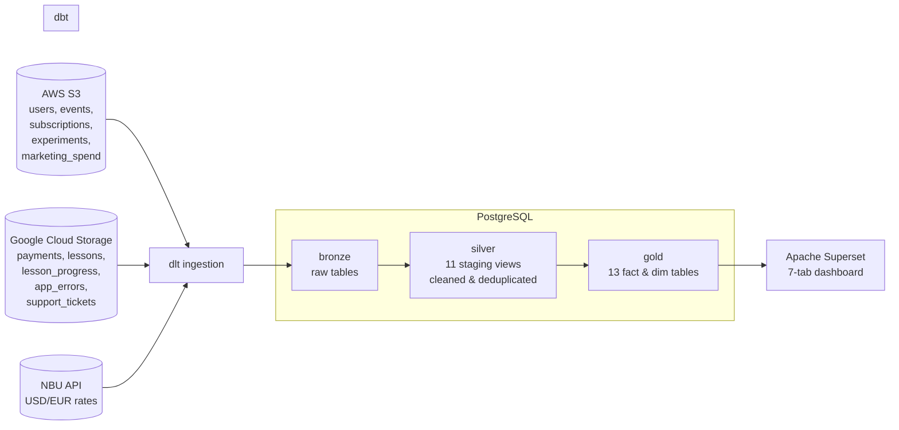
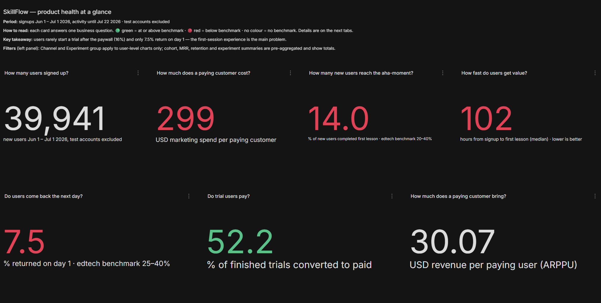
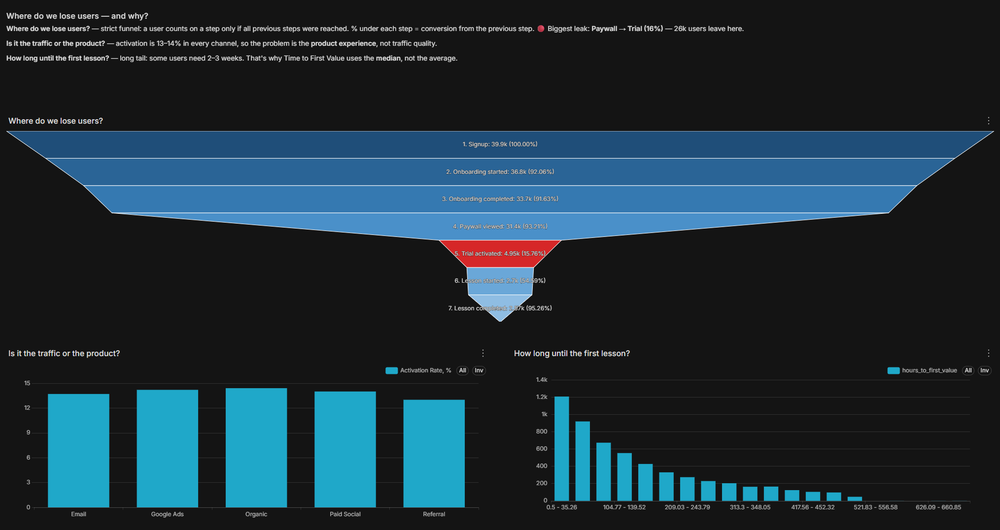
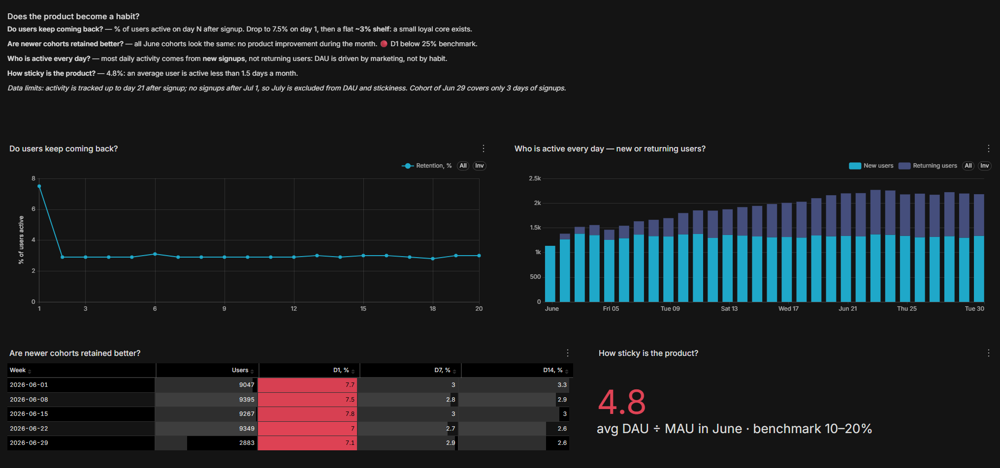
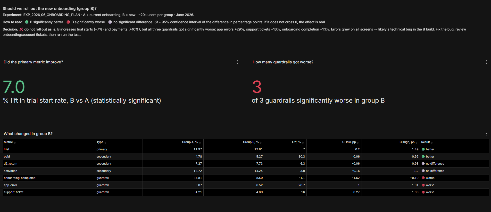

# SkillFlow — Product Analytics Pipeline

End-to-end analytics project for **SkillFlow**, a subscription e-learning app: raw data from **AWS S3**, **Google Cloud Storage** and the **National Bank of Ukraine API** is ingested with **dlt**, modelled with **dbt** in a **bronze → silver → gold** architecture on **PostgreSQL**, tested, documented, and visualised in an **Apache Superset** dashboard that explains itself.

## Business questions
- Where do new users come from and what do they cost? (**Acquisition**)
- Do users reach value, and where do we lose them? (**Activation & Funnel**)
- Does the product become a habit? (**Engagement & Retention**)
- Do users pay, and does acquisition pay back? (**Revenue**)
- Should we roll out the new onboarding tested in an A/B experiment? (**Experiment**)

## Architecture



## Tech stack
| Layer | Tool |
|---|---|
| Ingestion | **dlt** (filesystem source for S3/GCS, REST API for NBU) |
| Storage / warehouse | **PostgreSQL 18** |
| Transformation | **dbt-core 1.12** + dbt-postgres, **dbt_utils** |
| Data quality | **63 dbt tests** (unique, not_null, accepted_values, relationships, expression_is_true, accepted_range) |
| BI | **Apache Superset 6.1** in Docker, read-only DB user, dashboard exported as code |
| Version control | Git |

## Data layers
| Layer | Schema | Built by | Contents |
|---|---|---|---|
| **Bronze** | `bronze` | dlt | 11 raw tables, 1:1 with source files (CSV, JSONL) and API |
| **Silver** | `silver` | dbt (views) | `stg_*` models: deduplication, type casting, normalised categories, timezone fixes |
| **Gold** | `gold` | dbt (tables) | `dim_users`, `fct_payments` (USD via daily NBU rates), `fct_subscriptions`, `fct_user_activity`, `fct_funnel`, `fct_funnel_steps` (strict funnel), `fct_retention`, `fct_retention_curve`, `fct_mrr_daily`, `fct_user_revenue`, `fct_marketing`, `fct_experiment`, `fct_experiment_results` |

## Data quality
Source data was profiled table by table before modelling. Highlights:
- **~3,500 duplicate rows** removed (payments, users, subscriptions, events, experiments)
- amounts in **3 currencies and 4 formats** (`$9.99`, `416,25 UAH`, `3 332,92 UAH`, `9.25 EUR`) parsed and converted to USD with **daily NBU rates**
- **timezone bug**: part of `signup_at` stored as UTC text → parsed explicitly; duplicated events shifted by 3h → correct copy kept
- 11 spellings of the same subscription status, mixed-case categories, ISO country codes → normalised
- impossible values (completion > 100%, completion before start, negative spend, events before signup) → fixed or nulled
- known orphans (deleted users, missing lessons) kept and monitored with `warn`-level tests

Full report: [`soloskillflow/docs/data_quality.md`](soloskillflow/docs/data_quality.md)

## Dashboard
7 tabs, each answering one business question. Every chart title is a question, every tab has a "how to read" note, colours follow benchmarks (🟢 at/above, 🔴 below), and a **Glossary** tab defines every metric.

| Overview | Funnel |
|---|---|
|  |  |
| **Retention** | **Experiment** |
|  |  |

## Key findings
1. **The paywall is the biggest leak**: only **16%** of users who see it start a trial — 26k users lost at one step, equally in every channel.
2. **First experience does not hook users**: activation **14%**, D1 retention **7.5%** (edtech benchmark 25–40%); median time to first lesson **~4 days**.
3. **A small loyal core exists**: retention curve flattens at **~3%** from day 2 — a shelf, not a drop to zero.
4. **Users who try, pay**: Trial → Paid **52%**, refund rate **2.9%** — monetisation works once value is seen.
5. **Unit economics are negative**: ARPU **$1.5** vs CAC per signup **$16–29**; CAC per paying customer **$299** vs ~$9/month revenue. Paid Social is the cheapest paid channel, Email/Referral ~2× more expensive.
6. **A/B test — do not roll out as is**: the new onboarding lifts trial starts **+7%** (95% CI excludes 0), but all 3 guardrails got significantly worse (app errors **+29%**, support tickets **+16%**).

## How to run
```bash
# 1. Install
pip install "dlt[postgres,s3,gs]" pandas tqdm dbt-postgres

# 2. Credentials: create .dlt/secrets.toml (not in Git) with Postgres, AWS and GCP service-account credentials

# 3. Ingest to bronze
python ingest_s3.py
python ingest_gcs.py
python ingest_nbu.py

# 4. Build, test and document silver + gold
cd soloskillflow
dbt deps
dbt build
dbt docs generate && dbt docs serve

# 5. Dashboard: run Apache Superset 6.1 in Docker, connect a read-only Postgres user,
#    then Dashboards → Import → superset/dashboard_export (zipped)
```

## Project structure
```
├── ingest_s3.py / ingest_gcs.py / ingest_nbu.py   # dlt pipelines → bronze
├── soloskillflow/                                  # dbt project
│   ├── models/silver/                              # staging models + source & tests
│   ├── models/gold/                                # facts, dims, metrics models + tests
│   ├── macros/generate_schema_name.sql             # exact schema names (silver / gold)
│   └── docs/data_quality.md                        # profiling report
├── superset/dashboard_export/                      # dashboard as code (YAML)
└── docs/images/                                    # dashboard screenshots
```

## Limitations & next steps
- Data window: signups Jun 1 – Jul 1 2026, activity tracked up to day 21 after signup → D30 retention not measurable (D14 used).
- Ingestion is a full refresh (`replace`) — idempotent but reloads everything; next step: incremental loading by `dt` partition with `merge` + primary keys, and `incremental` dbt models.
- Orchestration (Airflow / Dagster) and CI for `dbt build` on every commit.

## Security
- Secrets live only in `.dlt/secrets.toml` and `~/.dbt/profiles.yml`, both outside Git.
- Superset connects with a **read-only** `superset_reader` role limited to the `gold` schema (granted by dbt `grants`).
- Superset runs locally with default dev settings — not intended for public exposure.